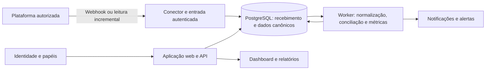

# Arquitetura de referência

Referência conceitual elaborada antes da revisão do sistema existente. As opções servem para comparar necessidades futuras caso a oferta exija mudanças. O planejamento comercial atual parte do sistema funcional relatado pelo proponente e deixa as decisões de arquitetura para depois da análise técnica.

## Hospedagem para a base existente

Na revisão de 16/11/2026, o sistema entregue utiliza servidor Node para o frontend, API Node/Express, MySQL 8.4 na documentação e um workflow n8n separado. PostgreSQL é uma opção conceitual para projetos futuros. A stack existente pode ser avaliada em sua forma atual. O SQL inclui views, concessões e uma collation específica do MySQL. [Diagnóstico](product-1-roadmap.md#diagnóstico-do-material-recebido-em-16112026)

- **Hostinger Premium:** manter as landing pages de engenharia e tecnologia. A Hostinger documenta aplicativos Node.js em Business/Unlimited e Cloud, e usa MariaDB nos planos Web e Cloud. A compatibilidade das migrações atuais exigiria teste mesmo em plano com Node.js. [Node.js na Hostinger](https://www.hostinger.com/support/how-to-deploy-a-nodejs-website-in-hostinger/) · [Banco da hospedagem Web](https://www.hostinger.com/support/1583226-which-database-management-system-is-used-at-hostinger/)
- **Oracle Always Free:** usar a VM existente para demo, com componentes compatíveis caso a VM seja ARM. A demo do frontend funciona sem banco e sem n8n. Uma prova completa usa banco e workflow de teste, com dados fictícios e sem credenciais da operação original. A Oracle pode recolher instâncias ociosas, e o Free Tier vem sem SLA. [Always Free](https://docs.oracle.com/en-us/iaas/Content/FreeTier/freetier_topic-Always_Free_Resources.htm) · [FAQ Oracle](https://www.oracle.com/cloud/free/faq/)
- **Primeiro piloto comercial:** dimensionar após medir volume, concorrência e custo da coleta, com isolamento, backup e restauração verificados. Um ambiente gerenciado e isolado por cliente é a hipótese inicial. A compra de VPS paga pode aguardar o escopo ou uma necessidade concreta de disponibilidade.

## Fluxo e responsabilidades

| Camada | Escolha inicial e motivo |
| --- | --- |
| Frontend | Aplicação web responsiva com filtros, data de atualização e exportação. Usar o framework já dominado pela equipe na fase de implementação. Formulários e gráficos comuns dispensam runtime analítico separado. |
| Backend/API e worker | Monólito modular e worker do mesmo projeto. Separar lógica de conector, métricas e permissões em módulos; usar jobs persistidos no Postgres e rotina agendada. Implantar web e worker de forma independente se houver necessidade operacional. |
| Dados | PostgreSQL gerenciado como primeira opção. Transações, consultas por período, modelagem relacional, índices e políticas por linha atendem ao escopo. Começar com consultas indexadas e agregados diários quando a medição justificar. |
| Integrações | Adaptador por origem com contrato de campos, capacidade de webhook/API/exportação, status de saúde e segredos próprios. Persistir metadados mínimos por padrão. Armazenar texto somente para finalidade acordada, com retenção definida. Arquivos e mídia ficam fora do piloto. |
| Automação com n8n | Avaliar para tarefas de operação e fluxos de serviço autorizados. Agendamento inicial e envio de alertas ficam também disponíveis no backend, preservando portabilidade. Lógica de métricas, dados canônicos e autorização residem no produto. |
| Identidade | Provedor OIDC gerenciado ou aprovado pelo cliente. Convites, MFA para perfis administrativos e revogação. Papéis: administrador da empresa, gestor, leitor e serviço de ingestão. Registrar acessos privilegiados, exportações e alterações de regra. |
| Visibilidade | Logs estruturados sem conteúdo de conversa, liveness e alertas de atraso, 401/429, erro por origem, falhas de jobs e discrepância com totais upstream. Expor última sincronização e cobertura por fonte ao usuário. |

**Licenciamento do n8n.** A licença comunitária restringe o uso comercial ao âmbito interno descrito em seus termos. Para hospedagem oferecida a terceiros, incorporação no produto, revenda ou processamento que acesse contas/credenciais de clientes, descrever o cenário ao fornecedor e obter confirmação escrita do direito aplicável antes de contratar. Até a confirmação, a arquitetura do piloto usa agendador e worker próprios para conectores. A opção consultiva no ambiente do cliente precisa de análise dos termos e dos papéis envolvidos. [Licença do n8n](https://github.com/n8n-io/n8n/blob/master/LICENSE.md)

## Ingestão e precisão

1. Registrar por fonte o escopo autorizado, campos disponíveis, timestamps, resolução de IDs, acesso a histórico e presença de eventos de atribuição/fechamento. Meta Cloud API ou um provedor autorizado são opções. Revisar permissões, coexistência e sincronização efetivamente suportadas para o número e o provedor, além da titularidade da conta e tarifas aplicáveis. [Meta WhatsApp Business Platform](https://developers.facebook.com/documentation/business-messaging/whatsapp/overview/) · [Tarifas Meta](https://developers.facebook.com/documentation/business-messaging/whatsapp/pricing/)
2. Para webhook, validar autenticidade, resolver tenant pela configuração do canal, gravar o recebido com chave idempotente e confirmar após persistir. Para leitura periódica, paginar a partir de cursor e janela de sobreposição. Avançar o cursor após gravação durável da página. Retentativas usam limites, espera progressiva e fila de falhas com reprocessamento auditado.
3. Normalizar empresa, origem, conversa, mensagem/evento, ator e timestamps. Ter chave única por empresa + origem + ID externo/tipo conforme contrato. Registrar tempo de evento e de processamento. Ordenar pela hora da origem com desempate determinístico. Reconciliar com exportação ou total autoritativo e recalcular janelas afetadas por eventos tardios.
4. Armazenar tempo em UTC e apresentar no fuso da operação. Separar versão de regra de sessão/SLA e calendário. Destacar atrasos, lacunas e dados insuficientes. Desabilitar indicadores dependentes de campos indisponíveis.
5. Alertas têm deduplicação por regra, conversa e janela, estado de envio, destinatário, fuso e supressão. Relatórios agregados podem ser enviados com link autenticado. Guardar entregas para reconciliação após falhas.

### Seleção do primeiro conector

| Candidato | Quando testar | Condição para pilotar |
| --- | --- | --- |
| Inbox já adotada, como Chatwoot | O prospect já centraliza a equipe e pode autorizar leitura. Chatwoot documenta eventos de conversa e mensagem. | Conciliar o histórico elegível e reconhecer ator, status e fila no plano/instalação real. Priorizar caso dois prospects qualificados usem a mesma fonte. [Webhooks Chatwoot](https://www.chatwoot.com/hc/user-guide/articles/1777049924-como-usar-webhooks) |
| WhatsApp Business Platform ou BSP | A conta tem acesso oficial e os eventos chegam pelo canal autorizado. | Demonstrar cobertura de mensagens, histórico disponível e associação a humano/fila na operação. A presença de webhook de mensageria deixa a atribuição dependente de eventos complementares quando o canal não a expõe. [Documentação Meta](https://developers.facebook.com/documentation/business-messaging/whatsapp/overview/) |
| Exportação autorizada | Há amostra íntegra e um formato repetível, com cadência aceitável para o cliente. | Aceite específico para painel em lote e alertas compatíveis com a cadência. Confirmar chave estável, coleta automatizável e custo de manutenção antes de vender recorrência. |

## Topologias

Faixas próprias para uma instalação de baixa carga e sem mão de obra, mensageria, licença comercial do n8n ou impostos. Validar com orçamento de hospedagem e volumes de eventos. As alocações por cliente em [preços](pricing-strategy.md) representam custo direto em operação compartilhada, com suporte modelado à parte.

| Modelo | Infra mensal ilustrativa | Complexidade e custo marginal | Vantagens e quando usar |
| --- | --- | --- | --- |
| Instalação individual gerenciada | R$ 150–450 por cliente | Setup e atualizações repetidos. Backups, monitoramento e versões por instalação. | Isolamento físico de dados e implantação simples para um primeiro cliente se houver contrato. Útil sob exigência de ambiente próprio. |
| SaaS multiempresa centralizado | R$ 350–900 pelo ambiente inicial, antes de crescer | Maior esforço inicial de autorização, RLS, testes e operação. Custo marginal tende a cair com conector e infraestrutura compartilhados. | Uma versão, observabilidade central, expansão replicável. Indicado após validar integração igual e demanda recorrente. |
| Híbrido | R$ 350–900 no núcleo + R$ 150–450 por implantação dedicada | Complexidade maior por partilhar control plane ou aplicação e operar recursos dedicados. Contratos e roteamento exigem escolhas explícitas. | Isolamento dedicado opcional para conta que financie o custo. Requer padrões maduros para evitar versões por cliente. |

**Opção de referência.** Um ambiente dedicado gerenciado pode servir ao primeiro piloto quando a operação existente e os contratos favorecerem essa topologia. A decisão de hospedagem e eventual migração dependerá da revisão autorizada, dos requisitos do cliente e dos custos de operação.

## Multi-tenancy, privacidade e continuidade

- No SaaS, usar `tenant_id` no modelo e chaves/relações compostas quando apropriado, com autorização pela identidade e associação do usuário à empresa. PostgreSQL RLS com papel de aplicação sem BYPASSRLS e sem propriedade das tabelas. Separar papel de migração, contexto de tenant por transação e testes de leitura/escrita cruzadas. Incluir jobs, cache, arquivos, exportações e restauração nos testes. [PostgreSQL Row Security](https://www.postgresql.org/docs/current/ddl-rowsecurity.html)
- TLS, criptografia em repouso, segredos segregados e rotacionáveis, controle de acessos, logs técnicos mínimos, trilha de auditoria e atualização de dependências. Backups testados e plano de recuperação. Como meta inicial, negociar RPO de 24 h e RTO de 8 horas úteis, sujeitos à arquitetura e ao teste de restauração.
- Documentar com o cliente controlador/operador conforme as atividades, finalidades, base aplicável, subprocessadores, avisos, direitos, exclusão e transferências internacionais. Proposta inicial: payload bruto até sete dias quando indispensável e histórico analítico por até 90 dias, configurável por contrato e necessidade. Definir prazo para backup, restauros e propagação de exclusões. Evitar conteúdo de saúde no primeiro escopo. A comunicação de incidente relevante segue regras da ANPD para o controlador. Contratar notificação do fornecedor sem demora para viabilizar o prazo aplicável. [LGPD](https://www.gov.br/mj/pt-br/assuntos/sua-protecao/sedigi/Lei13709.pdf) · [ANPD: incidentes](https://www.gov.br/anpd/pt-br/canais_atendimento/agente-de-tratamento/comunicado-de-incidente-de-seguranca-cis) · [ANPD: transferência internacional](https://www.gov.br/anpd/pt-br/acesso-a-informacao/institucional/atos-normativos/regulamentacoes_anpd/resolucao-cd-anpd-no-19-de-23-de-agosto-de-2024)
